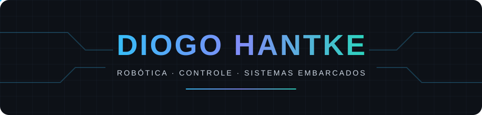

Graduando em Engenharia de Controle e Automação  
Técnico em Análise e Desenvolvimento de Sistemas

## Sobre mim

Desenvolvo projetos que conectam **software, eletrônica e controle**, com foco em sistemas embarcados e robótica móvel. Minha formação em desenvolvimento de sistemas e engenharia orienta meu trabalho na integração entre sensores, processamento e atuação física.

Utilizo **Python** no desenvolvimento de aplicações, algoritmos e ferramentas de software, além de **C e AVR Assembly** em projetos com microcontroladores. Meu portfólio reúne controle de motores, aquisição de sensores, comunicação entre dispositivos e interfaces para monitoramento e operação.

Atualmente, direciono meus projetos e minha pesquisa para **robôs móveis diferenciais e aplicações de inspeção**, com uso de ROS 2, modelagem, simulação e integração com plataformas físicas.

## Tecnologias

**Software e firmware**

**Sistemas embarcados**

**Robótica e simulação**

**Backend e ferramentas**

## Direção de pesquisa

Meu foco está na integração de **modelagem, controle e software para robôs diferenciais**, especialmente em aplicações de inspeção. Os temas que orientam essa trajetória incluem:

- Cinemática, controle de movimento e odometria.
- Aquisição de sensores, localização e fusão sensorial.
- Simulação e integração de sistemas com ROS 2.
- SLAM, planejamento de trajetórias e navegação autônoma.

Meu objetivo profissional é atuar em **pesquisa e desenvolvimento de sistemas robóticos**, conectando a implementação de software ao comportamento do sistema físico.

## Contribuições

<picture>
  <source media="(prefers-color-scheme: dark)" srcset="https://raw.githubusercontent.com/DiogoHantke/DiogoHantke/output/pacman-contribution-graph-dark.svg">
  <source media="(prefers-color-scheme: light)" srcset="https://raw.githubusercontent.com/DiogoHantke/DiogoHantke/output/pacman-contribution-graph.svg">
  
</picture>

## Contato

[LinkedIn — Diogo Hantke](https://www.linkedin.com/in/diogo-hantke-rodrigues-garcia/)
